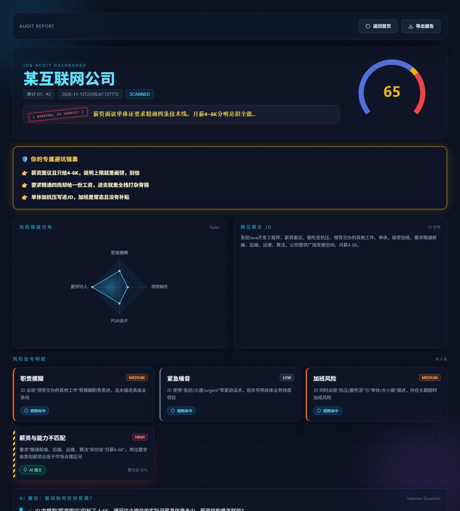
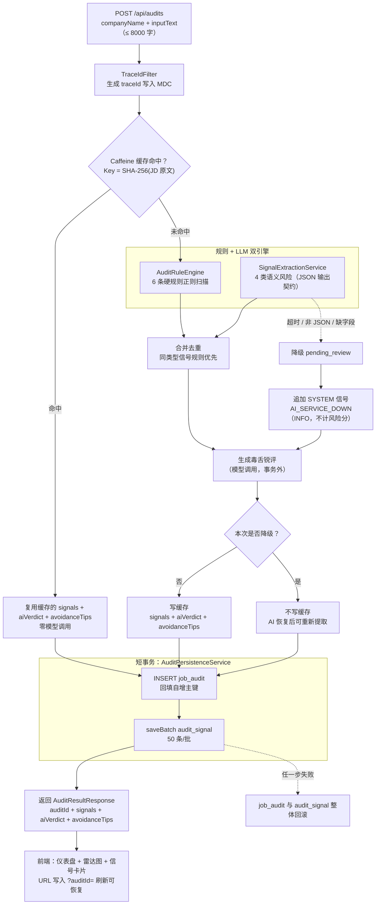

# job-audit 岗位反向尽调助手


输入一段招聘 JD，识别其中的风险信号——薪资不透明、职责模糊、要求矛盾、紧迫话术、招转培骗局、超长待机、PUA 话术、过度包装等，帮助求职者在投简历前"反向尽调"一家公司。

**规则引擎兜底确定性问题，大模型负责规则覆盖不到的语义陷阱；模型不可用时自动降级，绝不把"AI 挂了"伪装成"岗位安全"。**

## 🌟 比赛核心亮点

**1. 规则 + LLM 双引擎，各司其职**
6 条硬规则负责可枚举、可单测的确定性风险（薪资不透明、职责模糊、要求矛盾、紧迫话术、招转培、超长待机）；LLM 只处理规则写不出来的语义陷阱（PUA 话术、过度包装、职责过宽、薪资与能力错配）。同一 `signalType` 冲突时规则优先——确定性判断始终有兜底，不把解释权完全交给黑盒模型。

**2. 模型降级绝不伪装安全**
这是本项目在"AI 应用"里最在意的一条设计底线：当大模型超时、限流或输出非法 JSON 时，系统**不会静默返回"无风险"**，而是显式落一条 `source=SYSTEM` 的 `AI_SERVICE_DOWN` 信号，前端以琥珀色"系统提示"卡片明示"本次语义分析未生效"，且该信号不计入风险分。降级结果不写缓存，AI 恢复后同一段 JD 会自动重新分析。

> 宁可承认 AI 挂了，也不让求职者误以为这家公司是安全的。

**3. 三个 AI 输出视角严格分离**
同一批风险信号喂给模型，分别产出三种不重叠的言语行为：`aiVerdict` 只做**吐槽定性**（≤60 字）、`avoidanceTips` 只给**陈述式防御提醒**、`questions` 只写**第一人称追问**。Prompt 层面显式禁止越界，解析层再用"问句过滤 / 问号归一 / 长度截断"三道硬闸兜底。无风险信号时不出锐评，改为一句中性提示 `neutralVerdict`，避免"0 分却毒舌"的自相矛盾。

**4. 10 分钟零依赖复现**
H2 一键演示（不装数据库）→ 22 项自动化测试（无 MySQL、无 API Key 全绿）→ GitHub Actions 持续验证 → Docker / 本地 MySQL 两种完整部署方式。

🎬 [点击观看演示视频（B 站）](https://www.bilibili.com/video/BV1rfsB6CEiU)

📄 交付文档：[技术文档（HTML）](docs/technical-doc.html) · [技术文档（PDF）](docs/岗位反向尽调助手-技术文档.pdf) · [作品介绍（PDF）](docs/作品介绍文档.pdf)



---

## 技术栈

| 层 | 组件 | 版本 / 说明 |
|---|---|---|
| 后端 | JDK | 17 |
| 后端 | Spring Boot | 3.5.7（Web + Validation） |
| 后端 | MyBatis-Plus | 3.5.7（零 XML，`BaseMapper` 托管 CRUD） |
| 后端 | LangChain4j | 1.18.1-beta28（OpenAI 兼容协议，对接 DeepSeek） |
| 后端 | Caffeine | 进程内缓存，24h TTL / 2000 上限 |
| 后端 | Flyway | 数据库 schema 版本管理（V1 建表、V2 加列） |
| 后端 | 数据库 | MySQL 8+（开发实测 9.0）；演示模式用 H2 2.3 |
| 后端 | 接口文档 | Knife4j 4.5.0 + springdoc 2.8.9（默认关闭，按需启动） |
| 后端 | 日志 | SLF4J + MDC `traceId` 链路追踪 |
| 前端 | Vue | 3（`<script setup lang="ts">`） |
| 前端 | Vite | 8.3（`@vitejs/plugin-vue`） |
| 前端 | Tailwind CSS | 4.3（`@tailwindcss/vite`，暗色科技风） |
| 前端 | ECharts | 6.1（按需注册 GaugeChart / RadarChart） |
| 前端 | Element Plus | 2.14（按需引入 + `ElMessage` 全局异常提示） |
| 前端 | 其它 | TypeScript 7、axios、html2canvas-pro（报告导出） |

---

## 🤖 Vibe Coding 协同证据链

本项目严格遵循比赛规则，使用 **Trae** 作为 AI 辅助开发工具。AI 承担代码初稿、Prompt 迭代与文档整理；**架构决策、边界校验、代码评审与验收由人工把关**，因此每处 AI 产出都能对应到测试用例或实机验证记录。

**1. 每日 AI 会话快照：`prompts/sessions/`**

共 15 份，按开发顺序归档，记录了每一轮需求、AI 给出的方案、踩过的坑和最终取舍：

| 日期 | 主题 |
|---|---|
| 2026-10-29 | 健康检查接口 |
| 2026-10-30 | Flyway 迁移基线 |
| 2026-10-31 | 规则引擎 V1（6 条硬规则） |
| 2026-11-01 | Controller 与规则接入 |
| 2026-11-02 | 全局异常处理 |
| 2026-11-03 | 查询接口 |
| 2026-11-04 | 第一周小结 |
| 2026-11-05 | LangChain4j 结构化输出 |
| 2026-11-06 | LLM Prompt V1 |
| 2026-11-07 | Prompt V2 迭代与规则边界修复 |
| 2026-11-08 | 信号去重与持久化 |
| 2026-11-09 | Vue3 暗黑仪表盘 |
| 2026-11-10 | 最终 AI 特性：锐评 / 锦囊 / 追问三视角拆分 |
| 2026-11-11 | 工程优化：Caffeine 缓存、Knife4j、H2 演示模式 |
| 2026-11-16 | 仪表盘纯色动态配色与评分权重校准 |

**2. 全局约束文件：`.trae-context.md`**

仓库根目录的 `.trae-context.md` 用于约束 AI 的代码生成规范，内容包括技术栈锚点、包结构约定，以及四条硬性禁止项：不使用 Lombok、不用 Hibernate 自动建表（schema 只走 Flyway）、异常统一交给 `@ControllerAdvice`、LLM 解析失败必须降级 `pending_review` 而不是崩溃。每次让 AI 改代码前先读这份文件，保证生成结果始终对齐项目规约。

**3. Prompt 迭代可追溯**

核心 Prompt 的演进过程（语义提取 V1 → V2、三视角 Prompt 拆分）在快照中保留了原始 Prompt 文本、失败案例与修正理由，而不是只留最终版本。例如"锦囊最初被写成提问清单，与追问字段重叠"这个问题，其诊断与修正记录在 `2026-11-10_Final_AI_Features.md`。

**4. 人机分工声明**

| 环节 | 承担方 |
|---|---|
| 需求拆解、技术选型、模块边界 | 人工 |
| 代码初稿、正则与 Prompt 迭代、文档整理 | AI（Trae） |
| 事务边界、缓存策略、降级语义、安全收敛 | 人工评审后定稿 |
| 测试补齐、实机验证、CI 配置 | 人工 + AI 协作 |

---

## 核心架构



**四个关键设计点**

1. **规则 + LLM 双引擎**：6 条硬规则（确定、可单测、零依赖）负责 `salary_opacity` / `vague_duty` / `contradictory_req` / `urgency_noise` / `scam_risk` / `overwork_risk`；LLM 只负责规则覆盖不到的 4 类语义风险（`pua_culture` / `overpackaged` / `broad_duty` / `salary_mismatch`）。同一 `signalType` 冲突时规则优先。
2. **Caffeine 缓存**：JD 文本空白归一化后取 SHA-256 作为 Key，缓存 `signals + aiVerdict + avoidanceTips`，24 小时内同一段 JD 不再调用模型；读写均返回副本，避免落库回填的 `auditId` 污染缓存。
3. **降级兜底**：模型超时或输出非法 JSON → `pending_review`，并额外落一条 `source=SYSTEM` 的 `AI_SERVICE_DOWN` 信号（前端以"系统提示"样式展示、不计入风险分）。降级结果**不写缓存**，AI 恢复后同一 JD 会重新走语义提取。
4. **事务切分**：规则扫描、LLM 调用、合并去重、锐评生成全部在事务外完成，只有"主表插入 + 信号批量写入"进入 `@Transactional` 短事务，避免数秒级模型调用长时间占用数据库连接。

### 风险评分与配色

| 信号等级 | 权重 |
|---|---|
| HIGH | 30 |
| MEDIUM | 15 |
| LOW | 5 |
| SYSTEM（AI 降级提示） | 0，不计分也不参与雷达 |

总分 `min(95, Σ权重)`，刻意封顶 95 而不是 100：差 JD 也要保留"还有更差"的空间，避免所有问题岗位都挤在满分。

仪表盘颜色**只由总分决定**，整圈纯色、不使用渐变，避免"低分却看到红色"的误导：

| 分数 | 颜色 | 含义 |
|---|---|---|
| `< 60` | 绿 `#10b981` | 未命中或仅轻微风险 |
| `60 ~ 79` | 橙 `#f59e0b` | 存在需要核实的硬伤 |
| `>= 80` | 红 `#ef4444` | 多项高危叠加，建议谨慎 |

示例：`1 HIGH + 2 MEDIUM = 60`（橙）；`2 HIGH + 2 MEDIUM = 90`（红）；`5 HIGH = 150 → 95`（红，封顶）。

---

## 数据库表

Flyway 脚本位于 `src/main/resources/db/migration/`，启动时自动执行。

**V1__init.sql**：建表

| 表 | 字段 |
|---|---|
| `job_audit` | `id` / `input_text` / `company_name` / `status` / `created_at` |
| `audit_signal` | `id` / `audit_id`(外键) / `signal_type` / `severity` / `reason` / `confidence` / `source` / `created_at` |

**V2__add_ai_verdict.sql**：为 `job_audit` 增加两列

| 字段 | 类型 | 说明 |
|---|---|---|
| `ai_verdict` | `VARCHAR(255)` | AI 一句话毒舌锐评，生成失败时为 `NULL`（前端隐藏该区块） |
| `interview_questions` | `TEXT` | 面试反问话术，换行分隔；生成后回写，重复请求直接读库 |

> 演示模式（H2）不执行 MySQL 专有迁移脚本，改用 `src/main/resources/db/demo/schema-h2.sql`，结构与 V1 + V2 完全一致。

---

## 接口

| 方法 | 路径 | 说明 |
|---|---|---|
| GET | `/api/health` | 健康检查，返回 `{"status":"ok","project":"job-audit"}` |
| POST | `/api/audits` | 提交 JD 审计，body：`{"companyName":"...","inputText":"..."}`（`inputText` 上限 8000 字） |
| GET | `/api/audits/{id}` | 查询审计记录及关联信号，含 `aiVerdict` / `neutralVerdict` / `avoidanceTips`（避坑建议不落库：POST 时生成并随 JD 进入缓存，命中缓存直接复用，未命中才按需生成） |
| GET | `/api/audits/{id}/questions` | 生成面试反问话术（JD + 风险信号作为上下文；结果回写 `interview_questions`，重复请求命中缓存不入模型） |

> 接口描述默认关闭：`/v3/api-docs` 与 `/swagger-ui.html` 均返回 404，`/doc.html` 只剩无数据的静态外壳（Knife4j 前端资源），不包含任何接口结构。本地调试需要文档时：
> `mvn spring-boot:run -Dspring-boot.run.arguments="--springdoc.api-docs.enabled=true --knife4j.enable=true"`

响应示例（`POST /api/audits`）：

```json
{
  "auditId": 1,
  "companyName": "某公司",
  "inputText": "急招 Java 开发，薪资面议，能吃苦抗压，单休……",
  "status": "SCANNED",
  "createdAt": "2026-11-11T18:36:13",
  "signals": [
    {"signalType": "salary_opacity", "severity": "HIGH", "reason": "JD 标注薪资“面议”……", "source": "RULE"},
    {"signalType": "AI_SERVICE_DOWN", "severity": "INFO", "reason": "AI 服务暂时不可用……", "source": "SYSTEM"}
  ],
  "aiVerdict": "要求全栈大牛却只给 4-6K，还大谈狼性文化，建议快跑",
  "avoidanceTips": [
    "面试直接问死底薪数字，别听综合薪资画大饼",
    "让HR当场写出这个岗位每天固定工作项和业务线",
    "问清单休是哪天、周末加班有无法定补贴并写进合同"
  ],
  "neutralVerdict": null
}
```

> `neutralVerdict` 只在**零风险信号**时返回一句中性提示（此时 `aiVerdict` 为 `null`）；AI 降级时不返回中性提示，页面改为展示"AI 服务暂不可用"。

错误响应统一由 `GlobalExceptionHandler` 输出 `{code, message}`：400 参数校验（附具体字段原因）/ 404 记录或接口不存在 / 405 方法不支持 / 500 兜底（堆栈只进日志）。

---

## 10 分钟极速复现

### 复现性声明

- **依赖版本锁定**：`pom.xml` 固定所有依赖版本；`frontend/package-lock.json` 提交入库，`npm ci` 可复现；Dockerfile 固定基础镜像 tag。
- **自动化验证**：GitHub Actions 在干净的 Ubuntu 环境执行 `mvn test` 与 `npm ci && npm run build`，不依赖任何密钥或外部数据库（徽章见顶部，最近三次运行均为 success）。
- **零外部依赖启动**：H2 演示模式不需要 MySQL；`mvn test` 不需要 MySQL、API Key 与外网。
- **已知边界**：Docker 方式提供了完整 `Dockerfile` / `docker-compose.yml` 并通过 YAML 校验，但作者开发机未安装 Docker，未做本机端到端实测；H2 演示、本地 MySQL、自动化测试三种方式均已实机验证。

### 环境依赖清单

| 用途 | 是否必需 | 版本要求 | 说明 |
|---|---|---|---|
| 运行后端（H2 演示） | 必需 | JDK 17、Maven 3.6.3+ | 不需要数据库 |
| 运行前端 | 必需 | Node.js `^20.19.0 \|\| >=22.12.0`、npm | Vite 8 引擎要求 |
| 运行后端（MySQL） | 可选 | MySQL 8+ | 表结构由 Flyway 自动迁移 |
| 容器化部署 | 可选 | Docker 20.10+ / Compose v2 | 一条命令拉起 MySQL + 后端 |
| 自动化测试 | 可选 | 同上 JDK + Maven | H2 内存库，无需 MySQL / Key |

### 模式一：H2 极速体验（推荐，0 数据库配置）

**适用**：只想快速看效果，不想装 MySQL。
**前置**：仅需 JDK 17 + Maven。

```bash
.\start-demo.bat      # Windows：双击即可
./start-demo.sh     # Mac / Linux
```

脚本内只有一条命令：

```bash
mvn spring-boot:run -Dspring-boot.run.profiles=demo
```

`demo` profile 的行为：

- H2 内存库 `jdbc:h2:mem:jobaudit`，MySQL 兼容模式，启动时用 `schema-h2.sql` 建表
- `jobaudit.ai.enabled=false`：**关闭真实模型外呼**，语义提取 / 锐评 / 反问话术全部瞬时降级，一次审计约 0.4 秒返回，不会让评委等网络重试
- 数据在内存中，进程重启即清空
- 想体验真实大模型：设置 `LLM_API_KEY` 后，把外呼开关打开再启动（PowerShell 下参数必须加引号）：

```bash
mvn spring-boot:run -Dspring-boot.run.profiles=demo "-Dspring-boot.run.arguments=--jobaudit.ai.enabled=true"
```

验证：

```bash
curl http://localhost:8080/api/health
# {"status":"ok","project":"job-audit"}
```

### 🔐 环境变量模板（进入 MySQL / Docker 模式前必读）

仓库根目录提供 `.env.example` 模板，**仓库内不包含任何真实密钥**：`.env` 里只有指向 localhost 的前端地址，没有 API Key，也没有数据库密码。`.env` 已被 `.gitignore` 忽略，只有模板 `.env.example` 入库，因此你填入的真实 Key 不会被误提交。

```bash
cp .env.example .env        # Windows PowerShell: Copy-Item .env.example .env
```

| 变量 | 作用 | 默认值 | 配置位置 |
|---|---|---|---|
| `VITE_API_BASE_URL` | 前端请求后端的基地址 | `http://localhost:8080` | 根目录 `.env`（Vite 读取） |
| `DB_PASSWORD` | MySQL 密码 | `jobaudit`（仅 compose 内部网络兜底） | 系统环境变量 / IDEA 运行配置 / Docker 读取的 `.env` |
| `LLM_API_KEY` | DeepSeek API Key | 无 | 同上 |

配置方式二选一：

**A. 系统环境变量（命令行启动）**

```bash
export DB_PASSWORD=你的数据库密码      # Windows PowerShell: $env:DB_PASSWORD='你的密码'
export LLM_API_KEY=sk-xxxx            # Windows PowerShell: $env:LLM_API_KEY='sk-xxxx'
```

**B. IDEA 运行配置（在 IDE 里点启动按钮）**

`Run → Edit Configurations → 选中 JobAuditApplication → Environment variables`，填入：

```
DB_PASSWORD=你的数据库密码;LLM_API_KEY=sk-xxxx
```

注意事项：

- 后端**不读取** `.env` 文件（Spring Boot 没有 dotenv 机制），本地 `mvn spring-boot:run` 必须用 A 或 B；只有 Docker Compose 会自动读取根目录 `.env` 里的 `DB_PASSWORD` / `LLM_API_KEY`。
- 只有 `VITE_` 前缀的变量会注入浏览器端，**任何密钥都不要写进 `VITE_` 变量**，否则会被打进前端产物。
- 未设置 `LLM_API_KEY` 程序仍可正常启动，AI 能力降级为 `AI_SERVICE_DOWN` 系统提示，规则引擎结果照常输出。

### 模式二：MySQL 生产模式

**适用**：完整能力（真实 LLM 语义分析、数据持久化、Flyway 迁移、Docker 部署）。

1. 创建数据库（表结构由 Flyway 自动迁移）：

```sql
CREATE DATABASE job_audit_db DEFAULT CHARSET utf8mb4;
```

2. 注入环境变量：

```bash
export DB_PASSWORD=你的数据库密码          # Windows PowerShell: $env:DB_PASSWORD='你的密码'
export LLM_API_KEY=sk-xxxx                # Windows PowerShell: $env:LLM_API_KEY='sk-xxxx'
```

3. 启动：

```bash
mvn spring-boot:run
```

**或者用 Docker 一条命令拉起 MySQL + 后端**（前置：Docker Desktop / Docker Engine）：

```bash
docker compose up -d
curl http://localhost:8080/api/health
```

`docker compose` 会启动 MySQL 8.0、等待健康检查通过、构建并启动后端，Flyway 自动执行 V1/V2 迁移。

---

## 前端启动

**前置**：Node.js `^20.19.0 || >=22.12.0`（Vite 8 的引擎要求，开发实测 v22.16）。

```bash
cd frontend
npm install
npm run dev        # http://localhost:5173
```

生产构建：

```bash
npm run build      # 产物在 frontend/dist
```

### 接口地址配置（VITE_API_BASE_URL）

前端接口基地址读取环境变量，未配置时回落到 `http://localhost:8080`：

```ts
const BASE_URL = import.meta.env.VITE_API_BASE_URL || 'http://localhost:8080'
```

`.env` / `.env.example` 放在**仓库根目录**，因此 `frontend/vite.config.js` 里显式指定了 `envDir: '..'`：

```ini
# 根目录 .env（可复制 .env.example 修改）
VITE_API_BASE_URL=http://localhost:8080
```

注意：

- 只有 `VITE_` 前缀的变量会注入浏览器端，**不要在这里写任何密钥**
- `.env` 需保存为无 BOM 的 UTF-8，否则 Vite 会把键名读坏而静默失效
- 后端 CORS 放行 `http://localhost:5173` 与 `http://localhost:5174`（5173 被占用时 Vite 会自动顺延）

---

## 测试

```bash
mvn test
```

- 走 `test` profile，H2 内存库（MySQL 兼容模式）：**不需要本机 MySQL**
- 不依赖真实 `LLM_API_KEY` 与外网（`ChatModel` 用 Mock 隔离），无 Key 的机器上也能全绿
- 当前结果：`Tests run: 22, Failures: 0, Errors: 0, Skipped: 1`（跳过的是需手动开启的线上冒烟测试）
- 覆盖：规则引擎 14 项、事务回滚故障注入、Prompt 结构与解析契约、降级链路、Mock 隔离的模型调用参数
- 需要真打模型时手动执行：`mvn test -Dtest=ChatModelSmokeTest -Dllm.live=true`

---

## 目录结构

```
job-audit/
├── src/main/java/com/example/jobaudit/
│   ├── api/          Controller、TraceIdFilter、GlobalExceptionHandler
│   ├── config/       CORS、Knife4j
│   ├── domain/       record DTO 与实体
│   ├── rule/         AuditRuleEngine（6 条硬规则）
│   ├── service/      AuditService / SignalExtractionService / JdSignalCache / 持久化
│   └── mapper/       MyBatis-Plus Mapper
├── src/main/resources/
│   ├── application.properties          生产（MySQL）
│   ├── application-demo.properties     演示（H2，无外呼）
│   └── db/migration/                    Flyway V1 / V2
├── src/test/resources/                  H2 测试库 schema 与配置
├── frontend/                            Vue3 + Vite + Tailwind + ECharts
├── prompts/sessions/                    每日 AI 会话快照（Vibe Coding 证据链）
├── docs/                                交付文档与配图
│   ├── technical-doc.html               技术文档（可离线打开）
│   ├── 岗位反向尽调助手-技术文档.pdf     技术文档 PDF
│   ├── 作品介绍文档.pdf                  作品介绍 PDF
│   ├── assets/                          文档内嵌截图
│   └── images/result-page.png           结果页预览图（README 引用）
├── .github/workflows/ci.yml             后端测试 + 前端构建
├── .trae-context.md                     全局 AI 代码生成约束
├── .env.example                         环境变量模板（无任何真实密钥）
├── LICENSE                              MIT
├── Dockerfile / docker-compose.yml      一键部署
└── start-demo.bat / start-demo.sh       一键演示
```

---

## 已知限制与后续规划

**已知限制**（如实列出，避免过度承诺）

| 限制 | 说明 / 缓解方式 |
|---|---|
| 依赖外部大模型 | 需要 DeepSeek API Key；无 Key、断网或余额不足时自动降级，语义风险可能漏检——页面会显式提示"AI 服务暂不可用"，不会伪装成"无风险" |
| 无账号与鉴权 | 定位为单机、单人使用的求职辅助工具，接口未做登录与权限控制，不适合直接暴露在公网 |
| Docker 未本机实测 | `Dockerfile` / `docker-compose.yml` 已提供并通过 YAML 校验，但作者开发机未安装 Docker；H2 演示、本地 MySQL、自动化测试三种方式均已实机验证 |
| 缓存不跨实例 | Caffeine 为进程内缓存（24h TTL / 2000 条上限），多实例部署时不共享；当前为单实例部署 |
| 规则覆盖有限 | 6 条硬规则 + 4 类语义风险，只能覆盖常见套路；新骗术需持续补充规则与 Prompt |
| 评分是启发式 | 权重与阈值基于样本调校，用于横向比较与提示，不构成法律或决策依据 |

**后续规划**

- 历史记录页：目前刷新靠 URL 中的 `?auditId=` 恢复，尚不能浏览全部历史审计
- 多模型路由：主模型失败时切换备用模型，而不是直接降级
- 规则可配置化：把正则与权重移到配置/数据库，支持运营侧迭代
- 用户反馈闭环：允许用户标记"误报/漏报"，用于校准权重与 Prompt

---

## 开发规约

- 不使用 Lombok：实体手写 getter/setter，DTO 优先 Java 17 `record`
- 数据库结构变更只走 Flyway（`db/migration`），禁止运行时自动建表
- 异常统一走 `GlobalExceptionHandler`，不裸抛 500，不向前端泄漏堆栈
- 模型输出一律经服务端校验，解析失败降级 `pending_review`，不抛异常
- 关键链路日志通过 MDC 的 `traceId` 串联，用户 JD 原文与模型请求/响应不入日志
