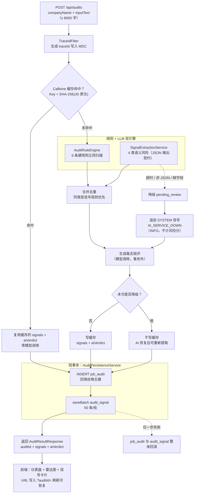

# job-audit 岗位反向尽调助手


输入一段招聘 JD，识别其中的风险信号——薪资不透明、职责模糊、要求矛盾、紧迫话术、招转培骗局、超长待机、PUA 话术、过度包装等，帮助求职者在投简历前"反向尽调"一家公司。

**规则引擎兜底确定性问题，大模型负责规则覆盖不到的语义陷阱；模型不可用时自动降级，绝不把"AI 挂了"伪装成"岗位安全"。**

---

## 技术栈

| 层 | 组件 | 版本 / 说明 |
|---|---|---|
| 后端 | JDK | 17 |
| 后端 | Spring Boot | 3.5.7（Web + Validation） |
| 后端 | MyBatis-Plus | 3.5.7（零 XML，`BaseMapper` 托管 CRUD） |
| 后端 | LangChain4j | 1.18.1-beta28（OpenAI 兼容协议，对接 DeepSeek） |
| 后端 | Caffeine | 进程内缓存，24h TTL / 2000 上限 |
| 后端 | Flyway | 数据库 schema 版本管理（V1 建表、V2 加列） |
| 后端 | 数据库 | MySQL 8+（开发实测 9.0）；演示模式用 H2 2.3 |
| 后端 | 接口文档 | Knife4j 4.5.0 + springdoc 2.8.9（默认关闭，按需启动） |
| 后端 | 日志 | SLF4J + MDC `traceId` 链路追踪 |
| 前端 | Vue | 3（`<script setup lang="ts">`） |
| 前端 | Vite | 8.3（`@vitejs/plugin-vue`） |
| 前端 | Tailwind CSS | 4.3（`@tailwindcss/vite`，暗色科技风） |
| 前端 | ECharts | 6.1（按需注册 GaugeChart / RadarChart） |
| 前端 | Element Plus | 2.14（按需引入 + `ElMessage` 全局异常提示） |
| 前端 | 其它 | TypeScript 7、axios、html2canvas-pro（报告导出） |

---

## 核心架构



**四个关键设计点**

1. **规则 + LLM 双引擎**：6 条硬规则（确定、可单测、零依赖）负责 `salary_opacity` / `vague_duty` / `contradictory_req` / `urgency_noise` / `scam_risk` / `overwork_risk`；LLM 只负责规则覆盖不到的 4 类语义风险（`pua_culture` / `overpackaged` / `broad_duty` / `salary_mismatch`）。同一 `signalType` 冲突时规则优先。
2. **Caffeine 缓存**：JD 文本空白归一化后取 SHA-256 作为 Key，缓存 `signals + aiVerdict + avoidanceTips`，24 小时内同一段 JD 不再调用模型；读写均返回副本，避免落库回填的 `auditId` 污染缓存。
3. **降级兜底**：模型超时或输出非法 JSON → `pending_review`，并额外落一条 `source=SYSTEM` 的 `AI_SERVICE_DOWN` 信号（前端以"系统提示"样式展示、不计入风险分）。降级结果**不写缓存**，AI 恢复后同一 JD 会重新走语义提取。
4. **事务切分**：规则扫描、LLM 调用、合并去重、锐评生成全部在事务外完成，只有"主表插入 + 信号批量写入"进入 `@Transactional` 短事务，避免数秒级模型调用长时间占用数据库连接。

---

## 数据库表

Flyway 脚本位于 `src/main/resources/db/migration/`，启动时自动执行。

**V1__init.sql**：建表

| 表 | 字段 |
|---|---|
| `job_audit` | `id` / `input_text` / `company_name` / `status` / `created_at` |
| `audit_signal` | `id` / `audit_id`(外键) / `signal_type` / `severity` / `reason` / `confidence` / `source` / `created_at` |

**V2__add_ai_verdict.sql**：为 `job_audit` 增加两列

| 字段 | 类型 | 说明 |
|---|---|---|
| `ai_verdict` | `VARCHAR(255)` | AI 一句话毒舌锐评，生成失败时为 `NULL`（前端隐藏该区块） |
| `interview_questions` | `TEXT` | 面试反问话术，换行分隔；生成后回写，重复请求直接读库 |

> 演示模式（H2）不执行 MySQL 专有迁移脚本，改用 `src/main/resources/db/demo/schema-h2.sql`，结构与 V1 + V2 完全一致。

---

## 接口

| 方法 | 路径 | 说明 |
|---|---|---|
| GET | `/api/health` | 健康检查，返回 `{"status":"ok","project":"job-audit"}` |
| POST | `/api/audits` | 提交 JD 审计，body：`{"companyName":"...","inputText":"..."}`（`inputText` 上限 8000 字） |
| GET | `/api/audits/{id}` | 查询审计记录及关联信号，含 `aiVerdict` 与 `avoidanceTips`（避坑建议不落库，24 小时内同段 JD 复用内存缓存） |
| GET | `/api/audits/{id}/questions` | 生成面试反问话术（JD + 风险信号作为上下文；结果回写 `interview_questions`，重复请求命中缓存不入模型） |

> 接口描述默认关闭：`/v3/api-docs` 与 `/swagger-ui.html` 均返回 404，`/doc.html` 只剩无数据的静态外壳（Knife4j 前端资源），不包含任何接口结构。本地调试需要文档时：
> `mvn spring-boot:run -Dspring-boot.run.arguments="--springdoc.api-docs.enabled=true --knife4j.enable=true"`

响应示例（`POST /api/audits`）：

```json
{
  "auditId": 1,
  "companyName": "某公司",
  "inputText": "急招 Java 开发，薪资面议，能吃苦抗压，单休……",
  "status": "SCANNED",
  "createdAt": "2026-11-11T18:36:13",
  "signals": [
    {"signalType": "salary_opacity", "severity": "HIGH", "reason": "JD 标注薪资“面议”……", "source": "RULE"},
    {"signalType": "AI_SERVICE_DOWN", "severity": "INFO", "reason": "AI 服务暂时不可用……", "source": "SYSTEM"}
  ],
  "aiVerdict": "要求全栈大牛却只给 4-6K，还大谈狼性文化，建议快跑",
  "avoidanceTips": [
    "面试直接问死底薪数字，别听综合薪资画大饼",
    "让HR当场写出这个岗位每天固定工作项和业务线",
    "问清单休是哪天、周末加班有无法定补贴并写进合同"
  ]
}
```

错误响应统一由 `GlobalExceptionHandler` 输出 `{code, message}`：400 参数校验（附具体字段原因）/ 404 记录或接口不存在 / 405 方法不支持 / 500 兜底（堆栈只进日志）。

---

## 10 分钟极速复现

### 模式一：H2 极速体验（推荐，0 数据库配置）

**适用**：只想快速看效果，不想装 MySQL。
**前置**：仅需 JDK 17 + Maven。

```bash
start-demo.bat      # Windows：双击即可
./start-demo.sh     # Mac / Linux
```

脚本内只有一条命令：

```bash
mvn spring-boot:run -Dspring-boot.run.profiles=demo
```

`demo` profile 的行为：

- H2 内存库 `jdbc:h2:mem:jobaudit`，MySQL 兼容模式，启动时用 `schema-h2.sql` 建表
- `jobaudit.ai.enabled=false`：**关闭真实模型外呼**，语义提取 / 锐评 / 反问话术全部瞬时降级，一次审计约 0.4 秒返回，不会让评委等网络重试
- 数据在内存中，进程重启即清空
- 想体验真实大模型：设置 `LLM_API_KEY` 后，把外呼开关打开再启动（PowerShell 下参数必须加引号）：

```bash
mvn spring-boot:run -Dspring-boot.run.profiles=demo "-Dspring-boot.run.arguments=--jobaudit.ai.enabled=true"
```

验证：

```bash
curl http://localhost:8080/api/health
# {"status":"ok","project":"job-audit"}
```

### 模式二：MySQL 生产模式

**适用**：完整能力（真实 LLM 语义分析、数据持久化、Flyway 迁移、Docker 部署）。

1. 创建数据库（表结构由 Flyway 自动迁移）：

```sql
CREATE DATABASE job_audit_db DEFAULT CHARSET utf8mb4;
```

2. 注入环境变量：

```bash
export DB_PASSWORD=你的数据库密码          # Windows PowerShell: $env:DB_PASSWORD='你的密码'
export LLM_API_KEY=sk-xxxx                # Windows PowerShell: $env:LLM_API_KEY='sk-xxxx'
```

3. 启动：

```bash
mvn spring-boot:run
```

**或者用 Docker 一条命令拉起 MySQL + 后端**（前置：Docker Desktop / Docker Engine）：

```bash
docker compose up -d
curl http://localhost:8080/api/health
```

`docker compose` 会启动 MySQL 8.0、等待健康检查通过、构建并启动后端，Flyway 自动执行 V1/V2 迁移。

---

## 前端启动

**前置**：Node.js `^20.19.0 || >=22.12.0`（Vite 8 的引擎要求，开发实测 v22.16）。

```bash
cd frontend
npm install
npm run dev        # http://localhost:5173
```

生产构建：

```bash
npm run build      # 产物在 frontend/dist
```

### 接口地址配置（VITE_API_BASE_URL）

前端接口基地址读取环境变量，未配置时回落到 `http://localhost:8080`：

```ts
const BASE_URL = import.meta.env.VITE_API_BASE_URL || 'http://localhost:8080'
```

`.env` / `.env.example` 放在**仓库根目录**，因此 `frontend/vite.config.js` 里显式指定了 `envDir: '..'`：

```ini
# 根目录 .env（可复制 .env.example 修改）
VITE_API_BASE_URL=http://localhost:8080
```

注意：

- 只有 `VITE_` 前缀的变量会注入浏览器端，**不要在这里写任何密钥**
- `.env` 需保存为无 BOM 的 UTF-8，否则 Vite 会把键名读坏而静默失效
- 后端 CORS 放行 `http://localhost:5173` 与 `http://localhost:5174`（5173 被占用时 Vite 会自动顺延）

---

## 测试

```bash
mvn test
```

- 走 `test` profile，H2 内存库（MySQL 兼容模式）：**不需要本机 MySQL**
- 不依赖真实 `LLM_API_KEY` 与外网（`ChatModel` 用 Mock 隔离），无 Key 的机器上也能全绿
- 当前结果：`Tests run: 22, Failures: 0, Errors: 0, Skipped: 1`（跳过的是需手动开启的线上冒烟测试）
- 覆盖：规则引擎 14 项、事务回滚故障注入、Prompt 结构与解析契约、降级链路、Mock 隔离的模型调用参数
- 需要真打模型时手动执行：`mvn test -Dtest=ChatModelSmokeTest -Dllm.live=true`

---

## 目录结构

```
job-audit/
├── src/main/java/com/example/jobaudit/
│   ├── api/          Controller、TraceIdFilter、GlobalExceptionHandler
│   ├── config/       CORS、Knife4j
│   ├── domain/       record DTO 与实体
│   ├── rule/         AuditRuleEngine（6 条硬规则）
│   ├── service/      AuditService / SignalExtractionService / JdSignalCache / 持久化
│   └── mapper/       MyBatis-Plus Mapper
├── src/main/resources/
│   ├── application.properties          生产（MySQL）
│   ├── application-demo.properties     演示（H2，无外呼）
│   └── db/migration/                    Flyway V1 / V2
├── src/test/resources/                  H2 测试库 schema 与配置
├── frontend/                            Vue3 + Vite + Tailwind + ECharts
├── Dockerfile / docker-compose.yml      一键部署
└── start-demo.bat / start-demo.sh       一键演示
```

---

## 开发规约

- 不使用 Lombok：实体手写 getter/setter，DTO 优先 Java 17 `record`
- 数据库结构变更只走 Flyway（`db/migration`），禁止运行时自动建表
- 异常统一走 `GlobalExceptionHandler`，不裸抛 500，不向前端泄漏堆栈
- 模型输出一律经服务端校验，解析失败降级 `pending_review`，不抛异常
- 关键链路日志通过 MDC 的 `traceId` 串联，用户 JD 原文与模型请求/响应不入日志
